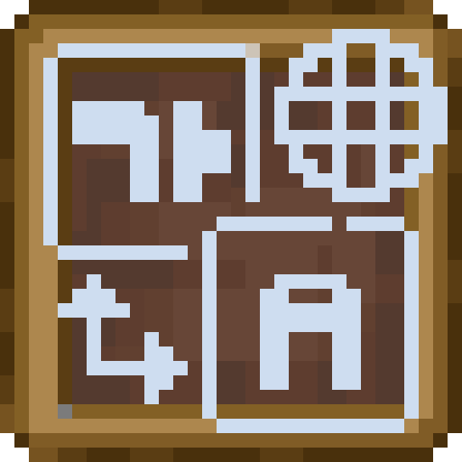

<div align="center">
  <a href="https://github.com/presentkim-pm/libmultilingual" target="_blank">
    
  </a>
  <h1>libmultilingual :: LocaleConverter</h1>
</div>

## :tada: Overview

This library given `LocaleConverter` which cross-convert `IETF` and `ISO 639-3` locale codes.  
Useful for convert the player's locale code to pocketmine-mp locale code.

- [`IETF`](https://en.wikipedia.org/wiki/IETF_language_tag) is the language code used by Minecraft. ex) `ko_KR`
- [`ISO 639-3`](https://en.wikipedia.org/wiki/ISO_639-3) is the language code used by pocketmine-mp language files.
  ex) `eng`

<details>
<summary>List of supports language codes</summary>

|             Name             | IETF  | ISO 639-3 |
|:----------------------------:|:-----:|:---------:|
|         English (US)         | en_US |    eng    |
|         English (UK)         | en_GB |    eng    |
|    Deutsch (Deutschland)     | de_DE |    deu    |
|       Español (España)       | es_ES |    spa    |
|       Español (México)       | es_MX |    spa    |
|      Français (France)       | fr_FR |    fra    |
|      Français (Canada)       | fr_CA |    fra    |
|      Italiano (Italia)       | it_IT |    ita    |
|           日本語 (日本)           | ja_JP |    jpn    |
|          한국어 (대한민국)          | ko_KR |    kor    |
|      Português (Brasil)      | pt_BR |    por    |
|     Português (Portugal)     | pt_PT |    por    |
|       Русский (Россия)       | ru_RU |    rus    |
|             简体中文             | zh_CN |    chs    |
|        繁體中文 (*)        | zh_TW |    chs    |
|    Nederlands (Nederland)    | nl_NL |    nld    |
|        Български (BG)        | bg_BG |    bul    |
|  Čeština (Česká republika)   | cs_CZ |    cze    |
|          Dansk (DA)          | da_DK |    dan    |
|      Ελληνικά (Ελλάδα)       | el_GR |    gre    |
|        Suomi (Suomi)         | fi_FI |    fin    |
|         Magyar (HU)          | hu_HU |    hun    |
| Bahasa Indonesia (Indonesia) | id_ID |    ind    |
|     Norsk bokmål (Norge)     | nb_NO |    nor    |
|         Polski (PL)          | pl_PL |    pol    |
|        Slovensky (SK)        | sk_SK |    slo    |
|      Svenska (Sverige)       | sv_SE |    swe    |
|       Türkçe (Türkiye)       | tr_TR |    tur    |
|     Українська (Україна)     | uk_UA |    ukr    |
|     Latviešu (Latvija)       | lv_LV |    lav    |
|    Tiếng Việt (Việt Nam)     | vi_VN |    vie    |

(*) PocketMine does not ship a Traditional Chinese language file, so `zh_TW` maps to Simplified Chinese (`chs`).

The codes of the languages PocketMine ships (`bul`, `chs`, `deu`, `eng`, `fra`, `ita`, `jpn`, `kor`, `lav`, `nld`, `rus`, `spa`, `tur`, `vie`) match its language file names.
The previously used legacy codes `ger` and `fre` are still found by `Translator` when no `deu`/`fra` language is registered.
When several tags share a code, `convertCode()` returns the first listed tag (ex: `eng` => `en_US`).

The list was taken from language_names.json in the Minecraft resource.
>
from [github@ZtechNetwork/MCBVanillaResourcePack](https://github.com/ZtechNetwork/MCBVanillaResourcePack/blob/cd647b3/texts/language_names.json)

I created this mapping data by referring to the dataset on the site below.
>
from [github@datasets/language-codes](http://github.com/datasets/language-codes/blob/d8f5a13/data/language-codes-3b2.csv)
</details>

-----
<br/>

## :book: What does provides?

This class provides the following static methods:

```php
/**
 * Convert IETF language tag to ISO 639-3 code
 *
 * @param string $locale The locale code in IETF format. ex) `en_US`
 * @return string|null the locale code in ISO 639-3 format. ex) `eng`
 */
public static function convertIETF(string $locale) : ?string

/**
 * Convert ISO 639-3 code to IETF language tag
 *
 * @param string $locale the locale code in ISO 639-3 format. ex) `eng`
 * @return string|null The locale code in IETF format. ex) `en_US`
 */
public static function convertCode(string $locale) : ?string

/**
 * @deprecated Use convertIETF() instead (correct spelling)
 */
public static function convertIEFT(string $locale) : ?string
```

[See source](https://github.com/presentkim-pm/libmultilingual/blob/main/src/kim/present/libmultilingual/utils/LocaleConverter.php)

-----
<br/>

## :book: How to use?

You can always use `LocaleConverter::convertIETF()` static method.

```php
//Example source that convert player locale code to pocketmine-mp locale code.  
use kim\present\libmultilingual\utils\LocaleConverter;

public function onPlayerJoin(PlayerJoinEvent $event) {
    $player = $event->getPlayer();
    $locale3char = LocaleConverter::convertIETF($player->getLocale());
    // Do something...
}
```

-----
